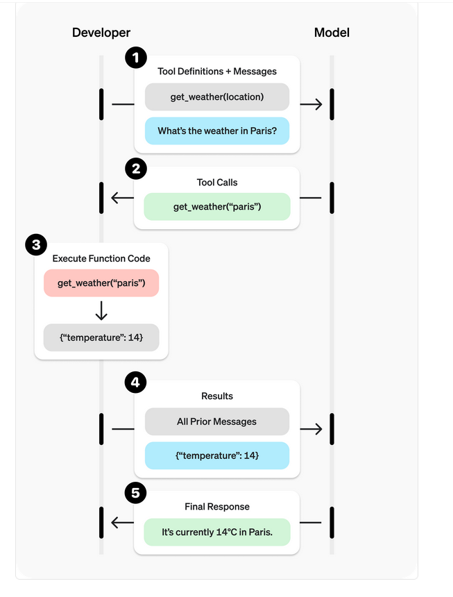

## Function Calling

1. Ability for models to interact with external tools and APIs.
2. Enables models to perform tasks that require real-time data or specific functionalities not inherent to the model itself.

3. Example

```python
from openai import OpenAI
import json

client = OpenAI()

# 1. Define a list of callable tools for the model
tools = [
    {
        "type": "function", // function schema
        "name": "get_horoscope",
        "description": "Get today's horoscope for an astrological sign.", 
        "parameters": {
            "type": "object",
            "properties": {
                "sign": {
                    "type": "string",
                    "description": "An astrological sign like Taurus or Aquarius",
                },
            },
            "required": ["sign"],
        },
    },
]

def get_horoscope(sign):
    return f"{sign}: Next Tuesday you will befriend a baby otter."

# Create a running input list we will add to over time
input_list = [
    {"role": "user", "content": "What is my horoscope? I am an Aquarius."}
]

# 2. Prompt the model with tools defined
response = client.responses.create(
    model="gpt-5",
    tools=tools,
    input=input_list,
)

# Save function call outputs for subsequent requests
input_list += response.output

for item in response.output:
    if item.type == "function_call":
        if item.name == "get_horoscope":
            # 3. Execute the function logic for get_horoscope
            sign = json.loads(item.arguments)["sign"]
            horoscope = get_horoscope(sign)
            
            # 4. Provide function call results to the model
            input_list.append({
                "type": "function_call_output",
                "call_id": item.call_id,
                "output": horoscope,
            })

print("Final input:")
print(input_list)

response = client.responses.create(
    model="gpt-5",
    instructions="Respond only with a horoscope generated by a tool.",
    tools=tools,
    input=input_list,
)

# 5. The model should be able to give a response!
print("Final output:")
print(response.model_dump_json(indent=2))
print("\n" + response.output_text)
```

4. Can use namespaces to group similar functions.
5. Tool Search: Models can search for tools based on their descriptions and parameters, allowing them to find the most relevant tool for a given task.

### Best Practices

1. Write clear function names, parameter description and instructions.
2. Use prompt to define when to use and when not to use the tools
3. Include examples and edge cases
4. Use software engineering best practices
   1. Make it obvious and intuitive
   2. Use enums
   3. Pass intern test -> can you give function to intern and what question is it going to ask!
5. Offload the burden from model and use code where possible
   1. Eg. If you have the order_id, dont pass as param to Submit_Refund(). Rather pass the order_Id with code and have no params
   2. Combine functions always called in sequence into one function. Eg. get_user_id() and get_user_email() can be combined into get_user_info()
6. Limit the number of functions. Use tool search to defer finding functions.