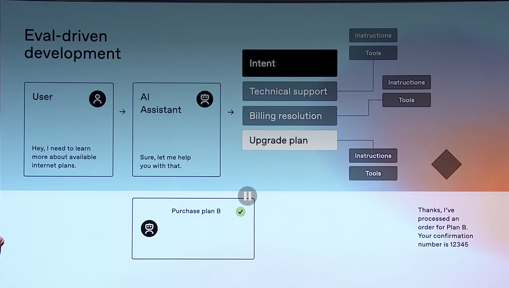
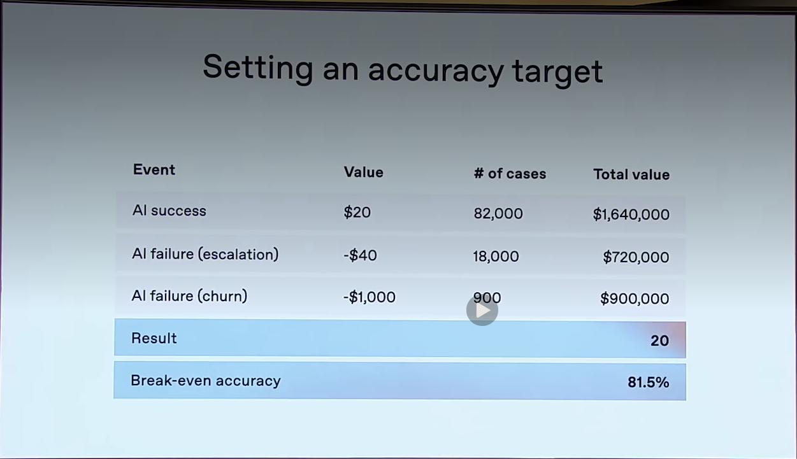
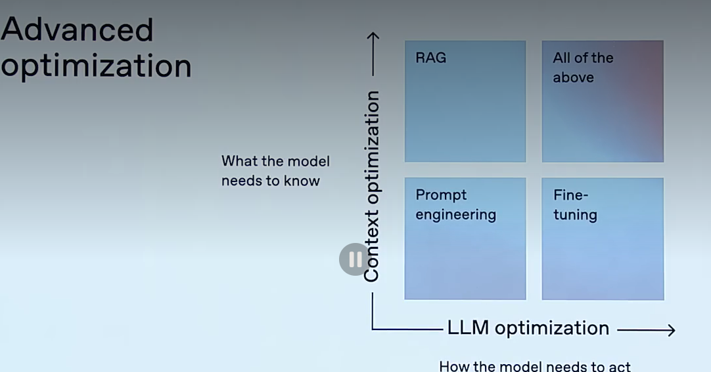
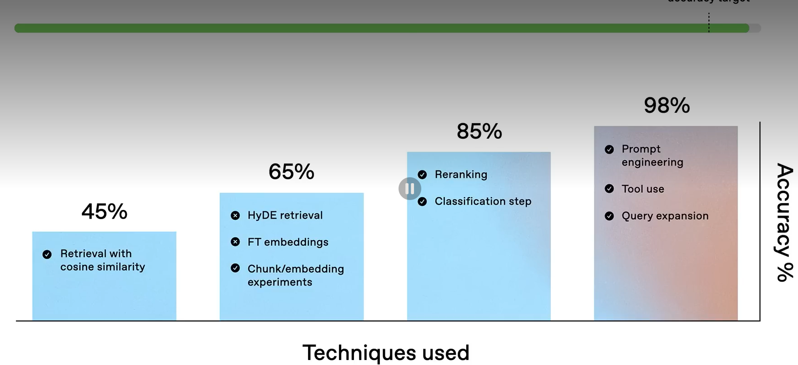
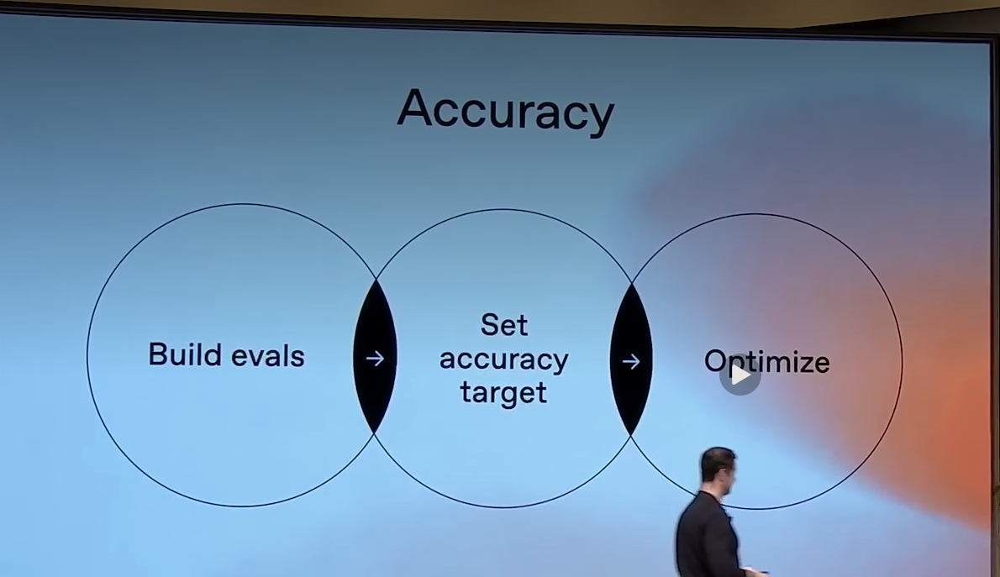
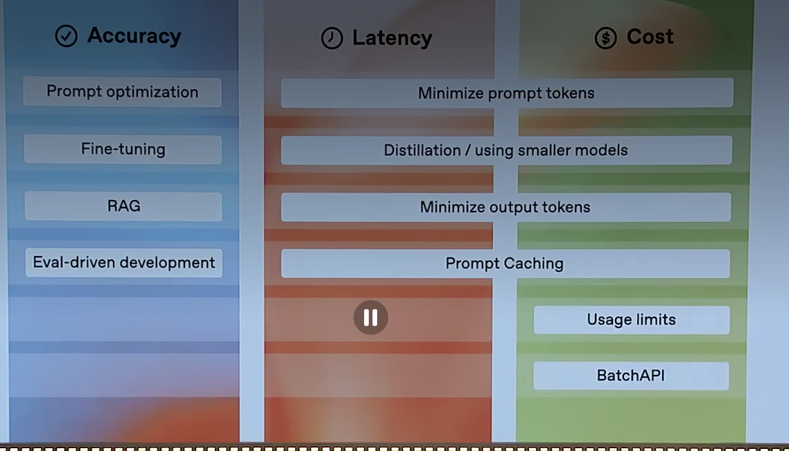

High Accuracy with least cost and latency!

    - Mine old customer transaction - eg customer wanted 30 dollar refund
    - Run that through LLM to pretend to be customer
        ○ Did it route correctly
        ○ Did the final output meet
    - Helps to see if customer service networks has regressed!
    - Automated Tests

    - Start with like 50 tests
    - Then to 400
    - Then to 1000s
        ○ Helps with regression!

Set an Accuracy Target = what is enough!!! Target Accuracy!

    1. Cost Model 
        a. Look at this, with AI success value, with AI failure value loss. With AI failure, customer give up. This helped calculate that 81.5% accuracy was the base line needed. Lets go for 90%!

    b. Wait, but we want 90% accuracy from the LLM? How much better is that compared to humans doing it?
        a. In the example above, when we did AB test with humans, human performed with 66% accuracy. SO even 81.5% is beating it very well! 90 IS AWESOME.

Ok, so we  have evals laid out, we have accuracy determined. NOW YOU GET TO OPTIMIZATION !!!

Optimization Techniques:
    1. Start with bottom left
        a. 

    a. Prompt Engineering
        a. Prompt stuffing with long context -> if you can fit
        b. Few shot examples
        c. Automated Prompt Optimization -> You have a master prompt where you tell it to look at your existing prompt, run your evals and then enhance the existing prompt  ==========> META PROMPTING
    b. RAG
        a. Not every problem needs semantic search
        b. Simple and obvious optimization ->< Best optimization is have Classification step on top
            i. Does this customer question require vector search, keyword or analytical response
            ii. Then based on classification, just query SQL. 
        c. Extend Evals to cover retrieval
            i. Extending every EVAL example to show the context that you have got and then highlight -> are we retrieving the right context that the model can actually answer with the content given!
    c. Fine Tuning
        a. Start small and build up
        b. Log positive and negative response and give feedback
        c. Like Meta Prompting and Retraining Model
    d. Reranker
        a. Taking  all the context and training domain specific re-ranker
        b. Eg. Depending on which domain we had question for, ,we had specific re-ranker which would re-rank the chunks!
    e. Adding Tools
        a. Like SQL tools so we can do correct search and run correct queries
    f. Query Expansion
        a. Add a Query expansion model to look at customer query and expand it further to infer the customer intent
        
Example Customer Scenario:

NOW How to handle latency and Cost !!!!!

Latency

Input Token latency (Time to first Token)
    Latency it takes to process prompts
        Solution
            1. Shorter Prompts - Prompt Improvoing
            2. It depends on the models too -> chose models some are fast , some are not
            3. Prompt Caching
Network Latency
    Time when we send request to time it takes for request to land on GPUs. This is all on OpenAI for example
    Regionalization by OpenAI will help so request don’t have to cross oceans everytime
Output Latency (time between tokens)
    - Supply and demand on Open AI side - Basically like a traffic
    - TPS -> Token per second per model configured per time
    - Shorter output length -> reduce number of tokens on response! BARE Minimum
    - Length of prompt makes difference!
    - Smaller models make things cheaper and faster too!

Cost!
    - Token save == cost save
    - Add alert for spending!
    - Prompt Caching!
        ○ Does not read prompt again, goes straight to generation
        ○ Prefix match from the beginning
            § If you change one character at the very beginning of the prompt, Cache miss
            § This means -> put static stuff at the beginning of the prompt
                □ Instructions on how Agent should work
                □ Few shot examples
                □ Tool calls
            § Then, later section of the prompt should include dynamic stuff like user information
    - BATCH API CALLS
        ○ Running reuqest async
        ○ Batch file with lot of requests and make one call --> 50% cost saving!
            § Content generation,
            § Evals,
            § Translation jobs
            § These can all be offloaded!
            § Eg. Customer requests come in, you summarize it, create requests and send one request!

